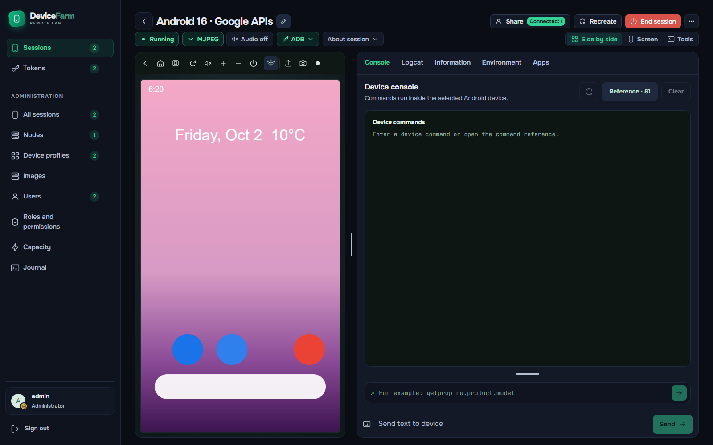

# Remote Device Farm

Run Android emulators on your own Linux/KVM servers and use them from a browser, CI or an AI assistant. The interface supports English and Russian.

**Alpha.** APIs and deployment settings may change. See the [verification matrix](docs/verification.md).

## What the service offers

| Feature | What it provides |
| --- | --- |
| **MCP for AI assistants** | Request a device, install and open an APK, inspect screenshots, UI trees and Logcat, find or tap elements, wait for UI changes and release it through a [local stdio MCP package](docs/ci/mcp.md). |
| **Browser device control** | Android screen, tap/swipe/text input, APK installation, screenshots, recording and device settings. [Sessions](docs/guides/sessions.md) |
| **ADB and session sharing** | Connect local development tools using personal ADB keys; share a session for viewing or control with expiration and revocation. [Access guide](docs/guides/sessions.md) |
| **CI integrations and Gradle** | Reusable packages for seven CI platforms, a Gradle plugin, and Maestro/Appium examples. [Setup and validation](docs/ci/README.md) |
| **Managed Appium (experimental)** | A session-scoped WebDriver API with a pinned Linux worker image; live automation remains under validation. [Status and limits](docs/ci/managed-appium.md) |
| **Virtual camera** | Upload an image to a compatible emulator's virtual scene for camera tests. [Requirements and verification](docs/guides/virtual-camera.md) |
| **Device pool and automation API** | Multiple worker nodes, resource limits, queues, explicit leases, team profile access and per-member quotas. [API](docs/api/README.md) |
| **GPU acceleration** | Software rendering or GPU modes using NVIDIA/CUDA and DRI, according to node capabilities. [Agent and GPU](docs/deployment/agent.md) |
| **Own image registry** | Build emulator images from the SDK catalog; manage versions, node caches, retention policies and cleanup from the UI. [Images](docs/guides/image-management.md) |
| **Application library and diagnostics** | Store APKs and APK sets, select compatible .apks parts, inspect Logcat and WebViews, capture HTTP/HTTPS connection metadata, export HAR and retain startup/stop diagnostics. [Guides](docs/README.md) |
| **Access administration** | Custom roles and permissions, users, personal API tokens and configurable authentication providers. [Security](SECURITY.md) |
| **Self-hosted deployment** | Docker Compose for a single host or separate server and Linux/KVM agents, with HTTPS and backup/restore tooling. [Deployment](docs/deployment/server.md) |

MCP ships from source as a local stdio adapter. CI packages also ship from source; external client/controller validation is incomplete. GPU and authentication-provider verification depends on the environment. [Tested and Not tested scenarios](docs/verification.md).

## CI and test automation

Use a shared device pool for Android tests across projects. Native reusable integrations are included for [TeamCity](docs/ci/teamcity.md), [GitHub Actions](docs/ci/github-actions.md), [GitLab CI](docs/ci/gitlab-component.md), [Jenkins](docs/ci/jenkins-library.md), [Azure Pipelines](docs/ci/azure-pipelines.md), [CircleCI](docs/ci/circleci.md) and [Bitbucket Pipelines](docs/ci/bitbucket-pipelines.md). A [Gradle plugin](docs/ci/gradle.md) and [Maestro](docs/ci/maestro.md)/[Appium](docs/ci/appium.md) examples support application test workflows.

The [Bash CLI](docs/api/README.md#готовый-помощник-для-ci) queues device requests, connects ADB, renews the lease during tests and releases the device after completion or cancellation. The examples include artifact collection. The packages share the CLI lifecycle and are available from source; live CI and Android plugin validation is still incomplete. [Setup and verification status](docs/ci/README.md).



[More screenshots](docs/screenshots/README.md) — current desktop interface with demo data.

## Quick start

One Linux host requires Docker Engine 28+, Compose 2.30+ with BuildKit, Node.js 22+, OpenSSL and access to `/dev/kvm`. Each Android image requires several GB of disk space.

```bash
git clone https://github.com/kavabunga6/remote-device-farm.git
cd remote-device-farm
node scripts/init-local.mjs
docker compose -f compose.yaml -f compose.agent.yaml -f compose.override.yaml up -d --build
```

Open [http://localhost:8088](http://localhost:8088). Sign in as **admin** with `LOCAL_ADMIN_PASSWORD` from the generated `.env` file.

1. In **Nodes**, check that the agent is online. Set slot resources; recent phone/tablet profiles require **4 CPU / 6 GB per slot**.
2. Review the [Android SDK/package terms](THIRD_PARTY.md#android-downloads-and-image-publication). In **Device profiles → Image catalog**, select an Android image and start a build. A single eligible node is selected as builder automatically.
3. After build validation and registry upload, enable the profile and create a session.

Initial image downloads and builds take several minutes. Later sessions use cached images.

> **Warning: prebuilt emulator images.** Third-party images, including vendor-published images, may disable ADB authentication or ignore supplied keys. A successful boot, a pinned digest or an ADB key environment variable does not establish that authentication is enforced. Before enabling a profile, verify that the emulator itself accepts a trusted key and rejects an independent untrusted client. Keep ADB, gRPC and emulator console endpoints isolated behind the service's access controls. [Image security requirements](docs/guides/images.md#готовые-сторонние-образы).

HTTP and registry ports bind to loopback. Remote access and additional nodes require a reachable HTTPS address and trusted certificates. ADB access uses the authenticated server proxy. Backups must include PostgreSQL, `app_store` and `registry_data`; store `SECRETS_KEY` separately.

## Verification

| Scope | Status |
| --- | --- |
| Linux single-host installation, server/agent connection, backup and restore | Tested |
| Google APIs / API 36.1 phone and tablet boot, ADB authentication; NVIDIA on phone | Tested |
| Desktop UI in English/Russian, light/dark themes; automated API and lifecycle checks | Tested |
| Two-account access isolation, screen sharing, revocation and expiration | Tested |
| Team profile access, per-member quotas, queue assignment and explicit leases | Tested |
| Bounded image builder: small image, export/import and cleanup | Tested; full SDK builds incomplete |
| UI-tree MCP, WebView inspection, signed APK sets and virtual-camera QR | Tested on one Android 16 Google APIs phone image |
| HTTP/CONNECT metadata, HAR, proxy restoration and agent recovery | Tested on the same image |
| PCAP packet capture | **Not ready** — [known limits](docs/verification.md#ограничения) |
| Additional deployment scenarios | **Not tested** — [verification matrix](docs/verification.md#not-tested) |

[Verification details and limitations](docs/verification.md). Physical-device rental requires a validated full reset/reprovisioning procedure for each model. Boot snapshots and privileged emulator containers are not available.

## Documentation

[Server, HTTPS and backups](docs/deployment/server.md) · [Agent and GPU](docs/deployment/agent.md) · [Registry](docs/deployment/registry.md) · [Profiles](docs/guides/images.md) · [Sessions](docs/guides/sessions.md) · [API](docs/api/README.md) · [OpenAPI](docs/api/openapi.yaml) · [CI integrations](docs/ci/README.md) · [Development](docs/development.md)

[All documentation](docs/README.md) · [Server configuration](.env.example) · [Agent configuration](.env.agent.example)

[Contributing](CONTRIBUTING.md) · [Security](SECURITY.md) · [Apache-2.0](LICENSE) · [Third-party terms](THIRD_PARTY.md)
