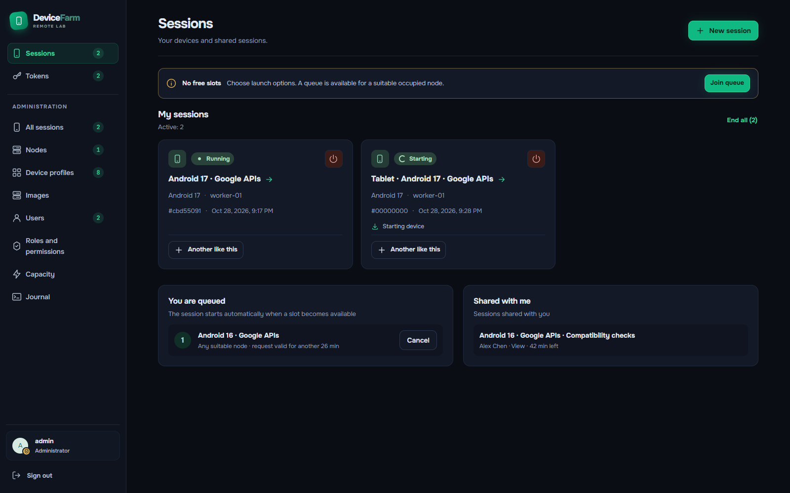
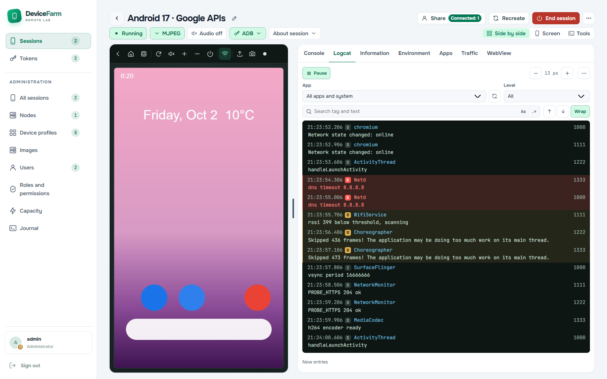
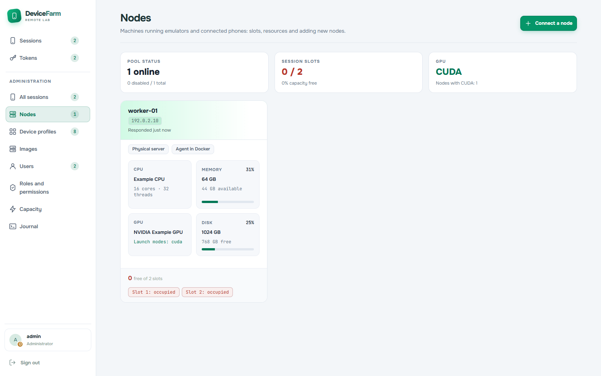
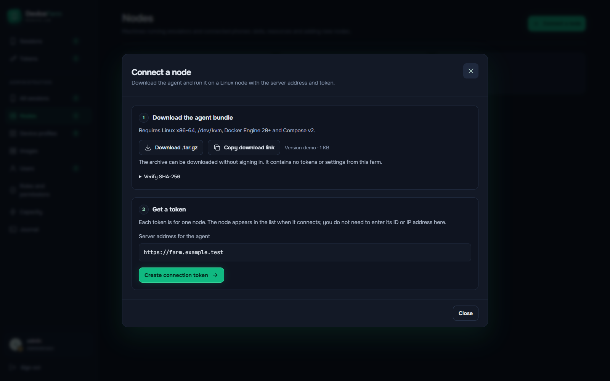
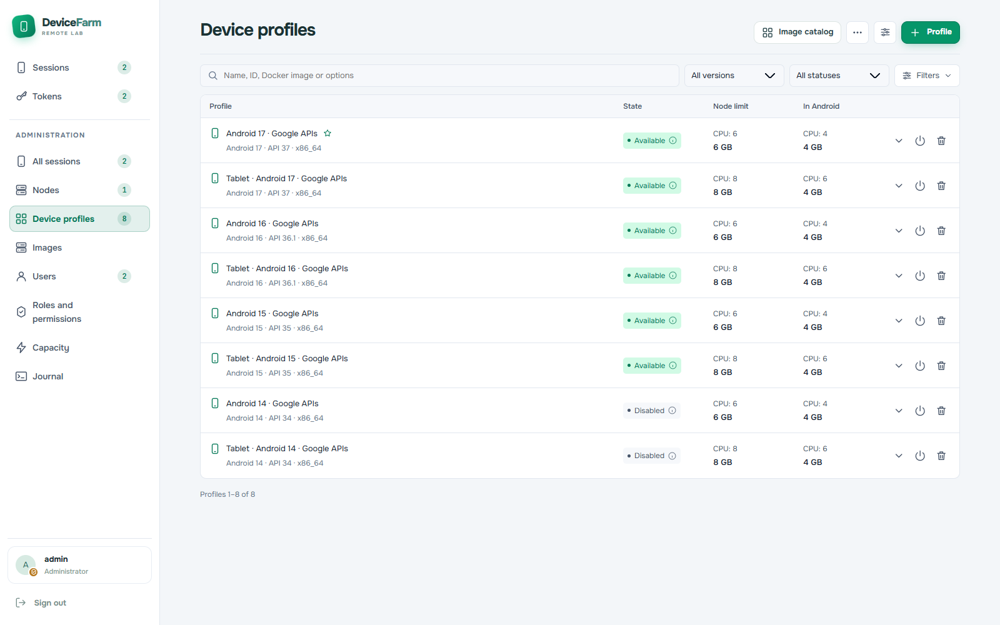
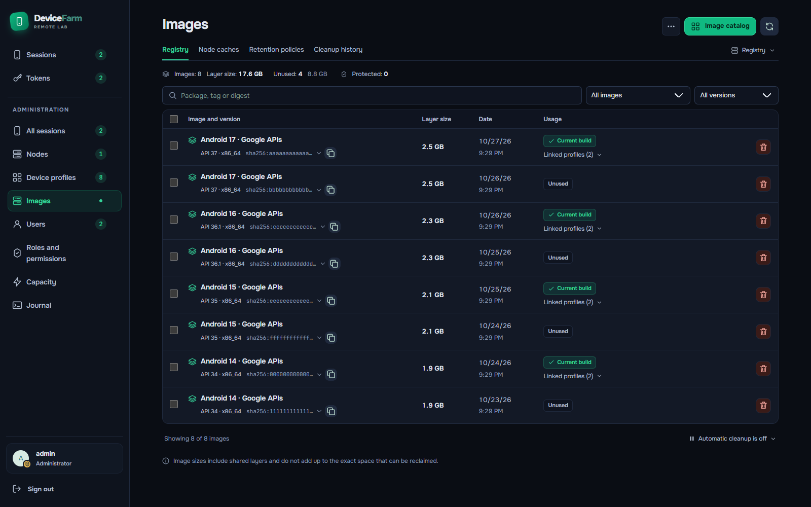
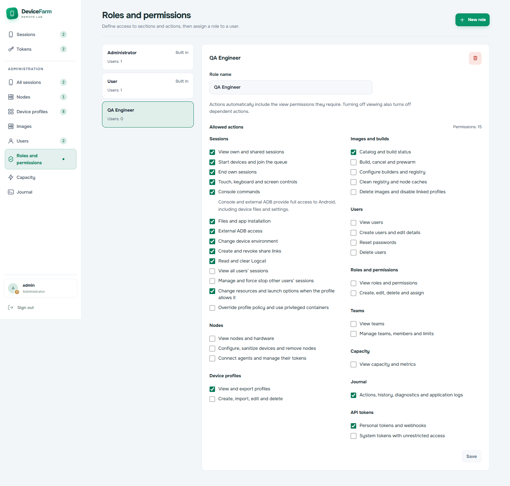
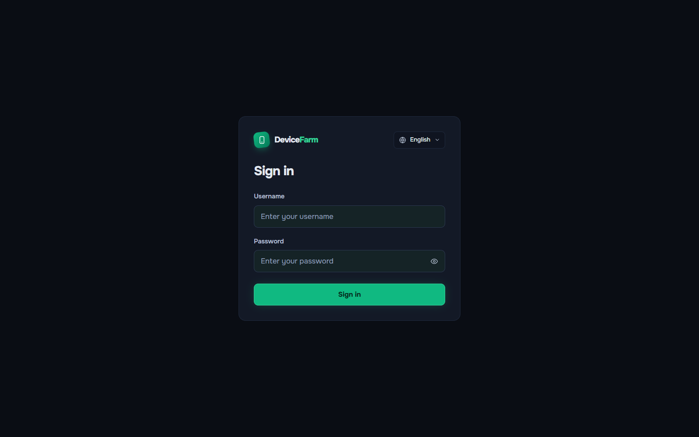

# Screenshots

Desktop interface, 1600 × 1000 viewport, English. The mock API supplies demo profiles, sessions, registry references and user roles. The Android display is a demo frame. These screenshots illustrate the interface; runtime verification is listed in [Verification](../verification.md).

## Device session

Screen controls, ADB access and device console.


## Sessions

Running and starting devices.



## Logcat

Log filters, follow/pause control and font size adjustment.



## Nodes

Slot allocation, resource capacity and agent status.



## Connect a node

Public archive download, a shareable download link and a separate token for each Linux node. The agent reads its connection settings on the node and appears in the farm after connecting.



## Device profiles

Searchable profile inventory with node and Android resource limits, status and expandable configuration.



## Images

Compact image inventory with filters, linked profiles, bulk selection and cleanup actions.



## Roles and permissions

Section access and action permissions for a custom role.



## Sign-in

Account sign-in and language selection.



## Capture

Install frontend dependencies with `npm --prefix frontend ci` and Chrome or Edge. Start the mock server in one terminal:

```bash
MOCK_PORT=5198 npm --prefix frontend run dev:mock
```

Run the capture script from the repository root in another terminal:

```bash
MOCK_PORT=5198 node scripts/capture-screenshots.mjs
```

For Edge, set `PLAYWRIGHT_CHANNEL=msedge` when running the capture script.

The script accepts only a loopback mock server, disables write requests, checks browser errors and horizontal overflow, and writes [capture metadata](manifest.json). Profile, node and role pages use full-page captures.
